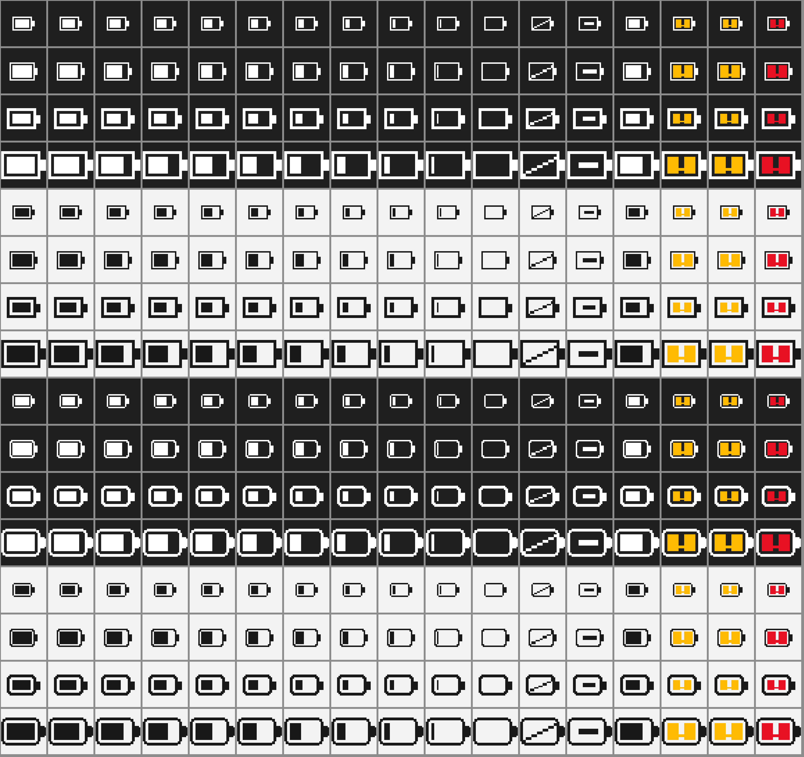

# PS Controller Battery Monitor (PSBatteryTray)

[中文说明](README.md) · **English**

A lightweight Windows tray utility that reads the **real battery level of PS4
(DualShock 4) and PS5 (DualSense) controllers** over HID and shows it in the
notification area, with multi-channel low-battery alerts.

Single-file executable. **No Python required, no administrator rights.**



---

## Why another battery widget?

Windows knows the battery level of a PlayStation controller — it is right there
in *Settings → Bluetooth & devices*, buried three clicks deep. And `XInput`
**cannot** read it at all: `XInputGetBatteryInformation` only works for Xbox
pads. So this tool talks to the controller the only way that works: it reads the
raw HID input reports and parses the battery byte itself.

The byte offsets are not guesswork — they are taken from the Linux kernel driver
`drivers/hid/hid-playstation.c`, which Sony engineers help maintain and which is
the de-facto public specification for the PS controller HID protocol.

## Features

| | |
|---|---|
| **Real battery level** | 11 discrete steps (0–10), the resolution the hardware actually reports. Displayed as "about 75% (level 7/10)" — never a fake precise number. |
| **Multiple controllers** | The tray icon shows the controller with the **lowest** charge, so you notice the one about to die. |
| **Low-battery alerts** | Three thresholds (30% / 20% / 10%), each fired once. Deliberately **multi-channel**: toast notification + taskbar icon blink + sound + a topmost popup. Windows 10 Focus Assist / Game Mode silently swallows toasts, so relying on them alone means missing the alert entirely. |
| **Two icon styles** | Windows 10 (square) and Windows 11 (rounded), switchable from the right-click menu at runtime. Chosen to match your actual taskbar. |
| **Theme aware** | Dark taskbar → white icon, light taskbar → dark icon. Follows a theme change within ~2 seconds. |
| **Honest about failure** | When the battery cannot be read, the icon shows a dash instead of a stale number. Anomalous values (voltage/temperature out of range) show as "unknown", never as 0%, so you never get a bogus "battery empty" alert. |
| **No install, no admin** | A single `.exe`. Writes only to `%APPDATA%\PSBatteryTray`. |

## Supported devices

| Device | USB | Bluetooth |
|---|---|---|
| DualShock 4 (PS4) | ✅ | ✅ (see note) |
| DualSense (PS5) | ✅ verified | not tested |
| Third-party "PS-compatible" pads | best effort | best effort |

**Note on DualShock 4 over Bluetooth.** The controller may only send the short
10-byte "minimal" report, which by protocol **has no battery field**. The tool
detects this, tells you so, and tries to switch the controller into full-report
mode. It will show "unknown" rather than inventing a number.

## Install

1. Download `PSBatteryTray.exe`.
2. Run it. It goes straight to the notification area — there is no main window.
3. Optional: enable *Start with Windows* from the right-click menu.

Windows SmartScreen may warn about an unknown publisher on first run
(the binary is not code-signed — a certificate costs money that a personal
project does not need). Click *More info → Run anyway*.

## Usage

**Right-click** the tray icon:

```
PS Controller Battery Monitor — about 15% (lowest)   ← click for details
—— Connected controllers ——
DualSense (PS5)  · USB    · about 75% (level 7/10) ⚡charging
DualShock 4      · Bluetooth · about 15% (level 1/10)
────────────────────────
☑ Start with Windows
  Icon style ▸ Windows 10 / Windows 11
────────────────────────
Refresh & show details
Open log folder
About
────────────────────────
Exit
```

**Left-click** opens a details window.

## Command line

| Command | What it does |
|---|---|
| `PSBatteryTray.exe` | Normal: tray only |
| `PSBatteryTray.exe --simulate` | Simulated timeline (plug in → drain → alerts → unplug). No controller needed — handy for verifying the whole chain. |
| `PSBatteryTray.exe --dump-hid 30` | Dump every HID device and its raw input reports for 30 s, then exit. This is the tool to reach for when readings look wrong. |
| `PSBatteryTray.exe --reset-config` | Restore default config and exit |
| `PSBatteryTray.exe --version` | Print version and exit |
| `PSBatteryTray.exe --console --debug` | Verbose logging to a console too |

## Configuration

`%APPDATA%\PSBatteryTray\config.json` — see the Chinese README for the full
table. The interesting keys:

| Key | Default | Meaning |
|---|---|---|
| `low_battery_thresholds` | `[30, 20, 10]` | Alert thresholds (percent, descending) |
| `alert_popup` | `"auto"` | Topmost popup: `auto` (only when notifications are suppressed) / `always` / `never` |
| `icon_style` | `"win10"` | `win10` (square) / `win11` (rounded) |
| `icon_accent_color` | `true` | Colour the icon amber/red on low battery |

A corrupted config does not crash the app: it falls back to defaults and renames
the broken file to `config.json.broken`. Writes are atomic (temp file + replace).

## Build from source

```bat
git clone https://github.com/izolita/PS-Controller-Battery-Monitoring.git
cd PS-Controller-Battery-Monitoring
python -m venv .venv
.venv\Scripts\pip install -r requirements.txt
build\build.ps1            :: runs tests, regenerates icons, packages the exe
```

Output: `Release\PSBatteryTray.exe` (single file, ~16 MB).

Run the test suite alone with `python tests\run_tests.py` — 96 tests covering
report parsing, alert policy, icon geometry and the tray refresh chain.

```
src/psbt/
  app.py                 orchestration, watchdog, theme following
  config.py              config load/save (atomic), validation
  controllers/           device discovery, HID reading, report parsing
    parsers.py           ← the protocol layer; offsets cite the kernel driver
    manager.py           multi-controller aggregation
  tray/
    iconart.py           pixel-exact icon drawing (both styles)
    hicon.py             exact-size HICON creation (no scaling)
    trayapp.py           pystray icon, dynamic menu, refresh throttling
  notify/                alert policy + toast / blink / sound / popup
tests/                   96 unit tests
tools/                   diagnostics: icon preview, HICON verification,
                         screen-level tray state checker
docs/                    protocol feasibility analysis (Chinese, detailed)
```

## Some engineering notes

These are the parts that took real debugging; they are documented in code
comments and in `docs/TECHNICAL_FEASIBILITY.md`.

**A report ID alone is not enough to parse a report.** Report `0x01` means
*different things depending on the bus*:

```
DualShock4 in USB uses the full HID report for reportID 1, but
Bluetooth uses a minimal HID report for reportID 1 and reports
the full report using reportID 17.
                                    — drivers/hid/hid-playstation.c
```

Some Bluetooth stacks pad the 10-byte minimal report to 64 bytes. A parser that
dispatches on report ID and length alone sees a "valid-length" report, reads the
battery byte at the USB offset, finds padding (`0x00`), and reports **"0 level,
about 5%"** — firing a false critical low-battery alert on every connect. The fix
is to dispatch on `(transport, report_id, length)`, exactly as the kernel does
with `hdev->bus`.

**Icon sharpness is decided outside your drawing code.** pystray loads the icon
via `LoadImage(..., LR_DEFAULTSIZE)`, which resolves to `SM_CXICON` (32 px), not
the notification area's `SM_CXSMICON` (16 px). The 16×16 source gets stretched to
32 and shrunk back to 16, and a one-pixel-wide battery outline turns to grey
mush. This project builds the HICON itself with `CreateIconIndirect` from an
exact-size DIB, so the code path contains no scaling at all — verified by reading
the HICON back and comparing pixels.

**Rounded corners without antialiasing.** The Win11 style rounds the corners by
integer pixel rejection inside an r×r corner block, so every pixel is either
fully opaque or fully transparent — no half-tones, no blurred edge at 16 px.

**Theme following is a polling trade-off, stated honestly.** A registry DWORD is
read once per second. Change the theme in Settings and the icon follows within
~1.9 s. It is polling, not an event subscription (`WM_SETTINGCHANGE` /
`RegNotifyChangeKeyValue` would be the zero-latency version) — a deliberate
simplicity/robustness choice, documented as a known limitation.

## License

MIT — see [LICENSE](LICENSE).

Not affiliated with Sony. "PlayStation", "DualShock" and "DualSense" are
trademarks of Sony Interactive Entertainment Inc.
